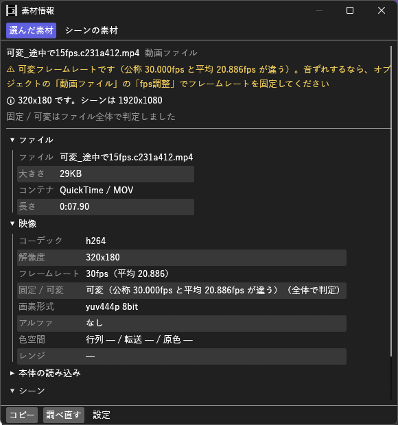

# MediaProbe_H マニュアル

**MediaProbe_H（素材情報）** は、タイムラインで選んだ動画・音声・画像オブジェクトの素材ファイルを調べる汎用プラグインです。
コーデック・フレームレートと**可変かどうか**・色空間・ビット深度・サンプルレートを出し、**シーンの設定と合わないもの**に印を付けます。
「音がずれる」「色が違う」ときに、原因が素材の側か編集の側かを切り分けるのに使います。

- **バージョン:** 0.3.0
- **作者:** by HexBrowns
- **必要環境:** AviUtl2 **2.1.11** 以上、FFmpegに入っている **ffprobe**

**読むだけのプラグインです。**
タイムラインにも素材ファイルにも書き込みません。

---

## 開き方

- **表示** メニュー → **素材情報**

表示リストに出ない場合はAviUtl2を再起動してください。

## 導入

1. [Releases](https://github.com/HexBrowns/MediaProbe_H/releases) から `HexBrowns.MediaProbe_H-v0.3.0.au2pkg.zip` をダウンロードし、AviUtl2のプレビューへドラッグ&ドロップする。
   手で置くなら、中の `Plugin` フォルダをデータフォルダ `C:\ProgramData\aviutl2` へコピーする。
2. AviUtl2を起動する。
3. ffprobeを用意する。同梱していないので、[FFmpeg](https://ffmpeg.org/download.html) に入っているものを使う。次の順に探します。
   1. ウィンドウの **設定** で指定した `ffprobe.exe`。
   2. `PATH` の通ったフォルダ。
   3. `Plugin` フォルダの一つ下のフォルダにある `ffprobe.exe`。

---

## 使い方

1. **表示** → **素材情報** を開く。
2. タイムラインで、動画・音声・画像のオブジェクトをクリックする。

ウィンドウの一番上の **フォーカス中のオブジェクト** に、そのオブジェクトの素材が出ます。
出すのは、オブジェクト設定に出ているフォーカス中の 1 つだけです。
複数を選んでいても 1 つしか出ません。

選ぶたびに素材ファイルを調べて出します。
同じファイルは 2 回調べません。ファイルを書き換えたときは **調べ直す** を押します。

### 一番上の印

シーンの解像度・フレームレート・サンプルレートと比べて、合わない点を出します。

| 印 | 出るとき |
|---|---|
| ⚠ **可変フレームレートです** | 音ずれの原因になりやすい素材。オブジェクトの **動画ファイル** の **fps調整** でフレームレートを固定してください |
| ⚠ **29.97fps です。シーンは 30fps** | シーンの整数倍でも約数でもないフレームレート |
| ⚠ **インターレースです** | 縞が出るなら、インターレース解除してから使ってください |
| ℹ **1280x720 です** | 解像度がシーンと違う |
| ℹ **44.1kHz です。シーンは 48kHz** | サンプルレートがシーンと違う |
| ℹ **HDR（PQ / HLG）です** | そのままでは白っぽく・暗く見えることがある |
| ℹ **10bit です** | 10bit 以上の素材 |

合わない点が無ければ「シーンの設定と合わない点はありません」と出ます。

### 表

| 欄 | 中身 |
|---|---|
| **ファイル** | ファイル名・大きさ・コンテナ・長さ |
| **映像** / **画像** | コーデック・解像度・公称と平均のフレームレート・**固定 / 可変**・画素形式とビット深度・アルファの有無・色空間の行列 / 転送 / 原色・フル / リミテッドのレンジ |
| **音声** | コーデック・サンプルレート・チャンネル・サンプル形式 |
| **本体の読み込み** | 本体がこのファイルを読んだときのトラック数・長さ・解像度 |
| **シーン** | 表示中のシーンの設定 |

値は選択してコピーできます。**コピー** で全部の項目をテキストでコピーできます。

### 全体で判定

**フォーカス中のオブジェクト** で動画を選ぶと **全体で判定** ボタンが出ます。
押すと、固定 / 可変を先頭 5 秒ではなく **ファイル全体** のフレームの間隔で判定し直します。
終わると表の **固定 / 可変** に「（全体で判定）」と出ます。
長い素材は時間がかかるので、調べている間は **やめる** で止められます。

先頭 5 秒では分からない「途中から間隔が揺れる素材」を見つけるためのものです。

### シーンの素材をまとめて調べる

ウィンドウの一番上で **シーンの素材** に切り替え、**シーンの素材を調べる** を押すと、表示中のシーンの動画・音声・画像の素材ファイルを全部調べます。

- 同じファイルを使うオブジェクトはまとめて 1 行にし、その下に使っているオブジェクトを、`L3 120` のようにレイヤーと開始フレームで並べます
- `L3 120` をクリックすると、そのオブジェクトにフォーカスが移ります。**フォーカス中のオブジェクト** に切り替えると詳しく出ます
  - 調べた後に、シーンを切り替えた・そのオブジェクトを消した・素材を差し替えたときは、フォーカスを移さずに理由を出します。調べたシーンに戻すか、**シーンの素材を調べる** で調べ直してください
- **注意があるものだけ** を外すと、注意の無い素材も出ます
- 調べている間は **やめる** で止められます。タイムラインで別のオブジェクトを選んでも止まりません。フォーカス中のオブジェクトの素材は、まとめて調べ終わってから調べます

### 設定

**設定** を押すと、`ffprobe.exe` の場所を指定できます。
空にすると、`PATH` と `Plugin` フォルダから探します。
使っているffprobeの場所も出ます。
欄に入れた場所は、**保存** を押すかEnterを押したときに保存します。他の場所をクリックしただけでは保存しません。
入力中にEscを押すと、入力する前の文字に戻ります。
設定は `Plugin\MediaProbe_H\設定.json` に保存されます。保存するときはffprobeの場所だけを書き換え、他の設定は消しません。

---

## 注意事項・制限

- 表に出るのは **素材ファイルの情報** です。本体がどう読んだかとは一致しないことがあります。本体の読んだ分は **本体の読み込み** の欄を見てください
- **可変フレームレートの判定** は、先頭 5 秒のフレームの間隔と、公称と平均のフレームレートの差で行っています。途中で 1 か所だけフレームが落ちた程度は「固定」と出ます
- 大きなファイルやネットワークドライブのファイルは、調べるのに時間がかかります。調べている間は「調べています」と出ます
- 調べている間に別のオブジェクトを選ぶと、前の分は途中でやめて、新しく選んだ方を調べます
- ウィンドウを出していない間は、オブジェクトを選んでも調べません。ウィンドウを出したときに、そのとき選んでいる素材を調べます
